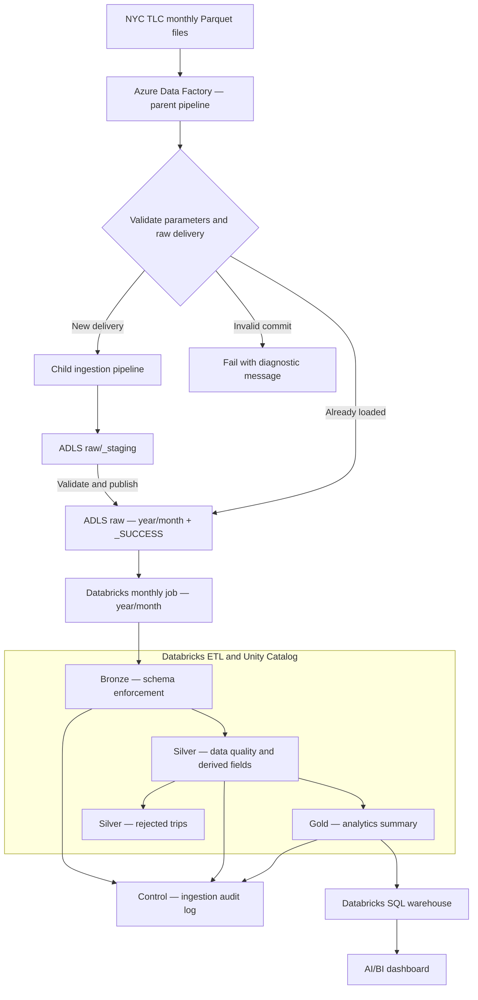

# NYC Yellow Taxi | Azure Data Engineering

An end-to-end monthly batch data pipeline that ingests public NYC Taxi & Limousine Commission (TLC) trip records, validates and transforms millions of rows, and serves curated analytics through an interactive Databricks dashboard.

**Technologies:** Azure Data Factory · ADLS Gen2 · Azure Databricks · PySpark · SQL · Delta Lake · Unity Catalog · Databricks Jobs · AI/BI Dashboards · GitHub

## Architecture



The raw and Delta layers reside in ADLS Gen2. Unity Catalog registers the Delta tables as external tables. ADF starts the existing Databricks job after successful raw ingestion or verification of an already-published delivery.

## Data source

Public NYC TLC Yellow Taxi monthly trip records in Parquet format. The input includes pickup and drop-off timestamps, location IDs, passenger counts, distances, fare components and payment codes.

Source: [NYC TLC Trip Record Data](https://www.nyc.gov/site/tlc/about/tlc-trip-record-data.page)

## Pipeline design

| Stage | Implementation |
| --- | --- |
| Raw | ADF validates year/month, checks the existing Parquet and `_SUCCESS` marker, downloads into run-specific staging, validates file size, and publishes the completed monthly file. |
| Bronze | Explicit 20-column schema; input file and marker checks; schema drift detection; ingestion timestamp, source file, source month and unique batch ID. |
| Silver | Classifies invalid records, records rejection reasons, derives pickup date/hour and trip duration, converts monetary values to decimals and reconciles accepted plus rejected counts. |
| Gold | Aggregates trips by pickup date, hour, location and payment type. Stores additive counts, charges, distance and duration for dashboard calculations. |
| Control | Records each ingestion attempt, start/end timestamps, row counts, status and error details. |

### Reliability and reprocessing

- ADF uses staging and a completion marker to distinguish successfully published monthly files from incomplete downloads.
- Delta Lake selective overwrite (`replaceWhere`) rebuilds the requested delivery month while preserving other months.
- Each processing attempt receives a unique batch ID. Downstream stages verify the upstream audit status and batch lineage.
- Schema drift fails the Bronze load before writing incompatible data. Invalid trip records are retained separately in Silver for investigation.
- Source-to-target reconciliation verifies Bronze counts, Silver dispositions, and Gold trip and monetary totals.
- Exception handlers record failures and propagate the original error to the orchestrator.
- Databricks tasks execute in dependency order, with one concurrent job run to prevent overlapping monthly processing.

## Storage and table inventory

| Layer | Unity Catalog table |
| --- | --- |
| Bronze | `nyc_taxi.bronze.yellow_taxi_trips` |
| Silver | `nyc_taxi.silver.yellow_taxi_trips` |
| Rejected | `nyc_taxi.silver.yellow_taxi_trips_rejected` |
| Gold | `nyc_taxi.gold.trip_activity_summary` |
| Audit | `nyc_taxi.control.ingestion_log` |

The raw delivery path follows `raw/nyc_taxi/yellow/year=YYYY/month=MM/`. Delta table storage is organized by layer in the corresponding ADLS containers.

## Analytics dashboard

The Gold table supports a filterable dashboard for trip volume, reported total charges, average trip charge, average distance and duration, daily trends, pickup hours, location demand and payment method distribution. Weighted averages use summed metrics divided by summed trip counts.

## Repository layout

```text
NYC_TAXI_Project/
├── pipeline/              # ADF pipeline definitions
├── dataset/               # ADF datasets
├── linkedService/         # ADF connection definitions
├── trigger/               # Monthly trigger configuration
├── factory/               # Data Factory configuration
├── databricks/
│   ├── notebooks/         # Setup, exploration and ETL notebooks
│   ├── utilities/         # Source schema definitions
│   └── tests/             # Development validation notebooks, if present
├── dashboard/             # Dashboard assets
├── docs/                  # Architecture and execution screenshots
└── README.md
```

## Run the project

1. Provision an Azure Data Factory, ADLS Gen2 account and Unity Catalog-enabled Azure Databricks workspace.
2. Create the raw, bronze, silver, gold and control containers; configure storage credentials and external locations. Run the setup notebook to initialize catalogs, schemas and the audit table.
3. Import the ADF definitions and Databricks source notebooks, preserving relative paths. Reconfigure linked services and storage paths for the target environment. Supply authentication credentials through secure configuration.
4. Configure the Databricks job `NYC_Taxi_Monthly_ETL` with dependent tasks `raw_to_bronze`, `bronze_to_silver` and `silver_to_gold`. Set `year` and `month` as job parameters.
5. Point the ADF Databricks Job activity to the deployed job. Execute the parent pipeline with a valid delivery year and two-digit month, for example `2025` and `01`.
6. Verify successful audit records and inspect the Gold table. Connect the dashboard to a SQL warehouse and select the Gold dataset.

## Validation and results

The project successfully processed a January source file containing **3,724,889 records**. Monthly reprocessing, preservation of other months, source and schema validation, and the integrated ADF-to-Databricks execution were tested. Both Silver and Gold notebooks completed successfully, and an interactive dashboard was built from the Gold table.

### Review data quality

```sql
SELECT source_year, source_month,
       source_row_count AS bronze_records,
       target_row_count AS accepted_records,
       source_row_count - target_row_count AS rejected_records
FROM nyc_taxi.control.ingestion_log
WHERE pipeline_name = '02_bronze_to_silver'
  AND status = 'SUCCESS'
QUALIFY ROW_NUMBER() OVER (
    PARTITION BY source_year, source_month
    ORDER BY start_time DESC, batch_id DESC
) = 1
ORDER BY source_year, source_month;
```

### Verify dashboard totals

```sql
SELECT SUM(trip_count) AS trips,
       SUM(total_amount_usd) AS reported_charges_usd,
       ROUND(SUM(total_distance_miles) / NULLIF(SUM(trip_count), 0), 2) AS avg_miles,
       ROUND(SUM(total_duration_seconds) / NULLIF(SUM(trip_count), 0) / 60, 2) AS avg_minutes
FROM nyc_taxi.gold.trip_activity_summary;
```

## Operational considerations

The monthly trigger is kept inactive when the learning environment is paused. Compute and SQL warehouses can be stopped between runs to control cloud costs. Re-running a failed or historical month uses the same year/month parameters. Silver and Gold are processed sequentially after Bronze, and the audit table preserves execution history across reruns.

This is an independently developed portfolio project using public taxi data.
